# Classification d'étoiles à partir des spectres APOGEE DR17 : 370 000 étoiles

Félix Dubé, Imran Akki, Charles-Antoine Fournier, Youssef Lahrichi, Bastien Posez
Projet de session GIF-4101 / GIF-7005 / GIF-7015, Université Laval, décembre 2026

Rapport complet : [`report/rapport.pdf`](report/rapport.pdf). Présentation : [`report/presentation.pdf`](report/presentation.pdf). Vue 3D des groupes : [`report/clusters3d/index.html`](report/clusters3d/index.html).

---

## Résumé

Nous classons 370 000 étoiles APOGEE DR17 à partir de leur seul spectre infrarouge. C'est 3,7 fois plus que la version précédente (99 773 étoiles) et 12 fois plus que la première (30 781). Le protocole ne change pas. Le code change pour tenir dans 15 Go de mémoire.

| Résultat | Valeur |
|---|---|
| Macro F1, CNN 1-D, 4 classes, meilleurs réglages (3 graines) | **0,865 ± 0,000** |
| Erreur sur Teff, CNN entraîné sur les bons spectres | **24,7 K** |
| ARI du GMM à 3 groupes, sans étiquettes | **0,41** |
| Naines regroupées dans un même groupe du GMM | **73 024 sur 73 040** |
| Red clump manqué par le catalogue red clump DR17 | **45 %** |
| F1 red clump / RGB contre l'astérosismologie APOKASC-3 | **0,978 ± 0,003** |
| Durée de l'expérience principale (RTX 3060 portable) | **2 heures** |

Trois messages :

1. Sans étiquettes, le spectre sépare naines, haut de la RGB et red clump avec bas de la RGB. Le choix k = 4 de la version 100 000 ne se reproduit pas.
2. Avec étiquettes, la régression profite le plus de l'échantillon plus grand. Les mauvais spectres aident la classification et nuisent à la régression sur les bons spectres.
3. La confusion red clump / RGB venait des étiquettes, pas du spectre. Avec les étiquettes d'astérosismologie, un CNN atteint 99 % de rappel et 3 % de contamination.

---

## 1. Introduction

APOGEE DR17 publie les spectres infrarouges de 657 000 étoiles. Le pipeline ASPCAP en tire la température effective Teff, la gravité de surface log g et la métallicité [M/H]. Notre question : un algorithme regroupe-t-il les étoiles en classes physiques à partir du spectre seul ?

Garcia-Dias et al. (2018) ont montré que K-means sépare naines, sous-géantes, red clump et RGB dans APOGEE. Leur résultat dépendait de l'initialisation. Nous testons ce résultat à grande échelle et suivons les trois demandes du cours :

1. Réduction de dimension (PCA, t-SNE, UMAP) pour voir si les classes se séparent.
2. Apprentissage supervisé avec un CNN 1-D, comparé à une forêt aléatoire.
3. Impact de la qualité des données : entraînement sur les bons spectres, puis sur tous.

Ce dépôt est la troisième version du projet :

| Version | Catalogue | Étoiles | Dépôt |
|---|---|---|---|
| 1 | `allStarLite` | 30 781 | [apogee-stars](https://github.com/imranakki/apogee-stars) |
| 2 | `allStar`, étiquettes enrichies | 99 773 | [apogee-stars-full](https://github.com/imranakki/apogee-stars-full) |
| 3 | `allStar`, mêmes étiquettes | 370 000 | ce dépôt |

Nous cherchons quels résultats tiennent quand l'échantillon grandit, et lesquels plafonnent.

---

## 2. Données

### 2.1 Échantillon

APOGEE observe en bande H (15 150 à 16 940 Å) à une résolution R ≈ 22 500. Chaque spectre normalisé (`aspcapStar`) compte 8 575 pixels. Le catalogue `allStar` compte 733 901 lignes.

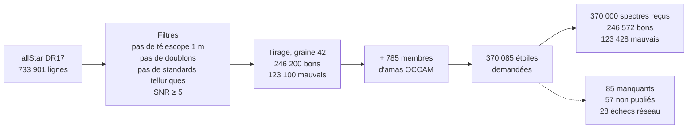

Un bon spectre vérifie quatre critères : SNR ≥ 70, `STARFLAG = 0`, pas de `STAR_BAD` dans `ASPCAPFLAG`, Teff et log g publiés. Le SNR médian vaut 168 pour les bons et 103 pour les mauvais. 69 % des mauvais spectres ont un SNR ≥ 70 : un drapeau les écarte, pas le bruit.

| | Version 1 | Version 2 | Version 3 |
|---|---:|---:|---:|
| Étoiles | 30 781 | 99 773 | 370 000 |
| Bons spectres | 20 000 env. | 66 372 | 246 572 |
| Mauvais spectres | 10 000 env. | 33 401 | 123 428 |
| Étiquettes FPARAM | 0 | 2 815 | 10 361 |

### 2.2 Étiquettes

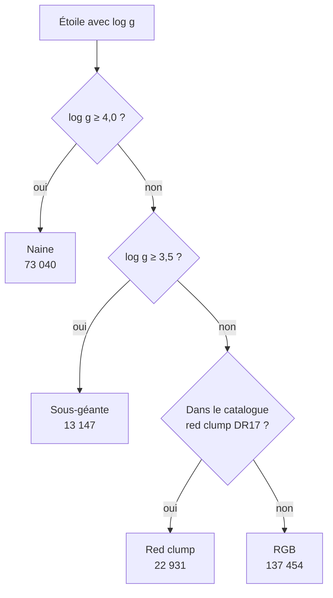

Effectifs sur les bons spectres. Les populations suivent [Mg/Fe], [Fe/H] et la distance Gaia EDR3 :

| Population | Critère | Bons spectres |
|---|---|---:|
| Disque mince | sinon | 175 184 |
| Disque épais | [Mg/Fe] > 0,12 − 0,13 min([Fe/H], 0) | 49 879 |
| Bulbe | moins de 3 kpc du centre galactique | 9 936 |
| Halo | [Fe/H] < −1 | 8 164 |

359 639 étoiles portent une étiquette ASPCAP et 10 361 une étiquette FPARAM, l'ajustement brut qu'ASPCAP a rejeté.

### 2.3 Prétraitement et découpage

Nous retirons les 1 061 pixels des trous entre détecteurs (il reste 7 514 pixels), remplaçons chaque pixel douteux par 1 et bornons le flux entre 0 et 1,5. Les réseaux reçoivent 1 − flux, la profondeur des raies.

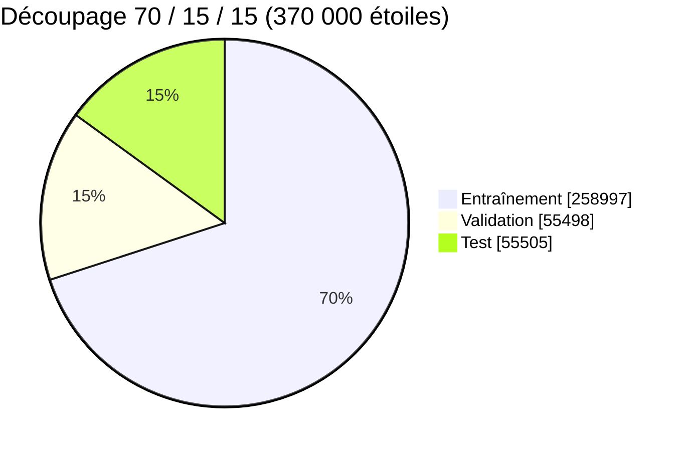

Le test compte 37 034 bons spectres (`test_good`). Tous les scores ci-dessous portent sur `test_good`, sauf mention contraire.

---

## 3. Tenir 370 000 spectres dans 15 Go

En float32, 370 000 spectres de 7 514 pixels occupent 11,1 Go. La machine a 15 Go de mémoire, dont 10 Go libres. Le code de la version 2 dépassait la mémoire à trois endroits.

| Changement | Avant | Après |
|---|---:|---:|
| Spectres stockés en float16 (`features_X.npy`) | 11,1 Go | 5,6 Go |
| Lots lus ligne par ligne, convertis en float32 au vol | copie de 3,9 Go | un lot |
| PCA ajustée sur 50 000 spectres, projection par morceaux | 11 Go | 1,5 Go |
| HDBSCAN sur 50 000 étoiles tirées au hasard | toutes | 50 000 |

Float16 suffit. Près du continuum, son pas vaut 0,0005, vingt fois moins que le bruit d'un bon spectre (environ 0,01 par pixel). Détails dans [`docs/memoire.md`](docs/memoire.md).

---

## 4. Méthodes

### 4.1 Pipeline

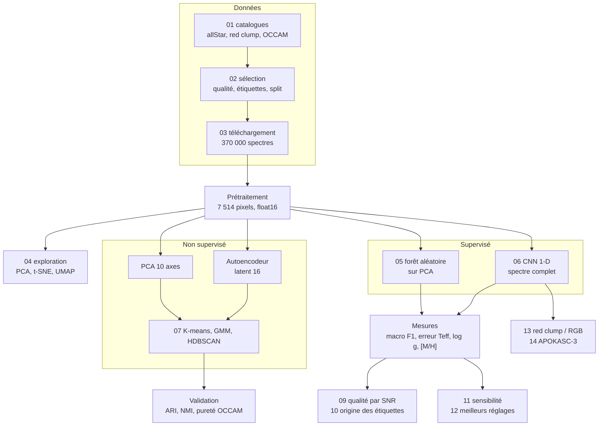

### 4.2 Modèles

- **Réduction de dimension.** PCA à 50 composantes (10 axes portent 74,7 % de la variance), t-SNE sur 10 000 étoiles.
- **Autoencodeur.** Réseau dense 7 514 → 512 → 128 → 16 et retour, perte quadratique.
- **Clustering.** K-means, GMM à covariances pleines et HDBSCAN, sur 10 composantes PCA standardisées ou sur le latent de l'autoencodeur. k choisi par la silhouette. Stabilité mesurée par l'ARI moyen entre 10 graines.
- **Validation du clustering.** ARI, NMI, pureté des 120 amas ouverts OCCAM.
- **Forêt aléatoire.** 300 arbres sur 50 composantes PCA.
- **CNN 1-D.** 150 000 paramètres, Adam, taux 0,001, lots de 128, 30 époques, meilleure époque de validation gardée. Deux tâches : 4 classes, et régression de Teff, log g, [M/H].

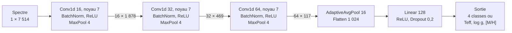

Un noyau de 7 pixels couvre une raie. Trois blocs ramènent 7 514 pixels à 117.

### 4.3 Expérience qualité

Chaque modèle s'entraîne deux fois : sur les bons spectres (172 512 étoiles), puis sur tous (258 997). La validation reste sur les bons spectres pour que chaque run choisisse son époque sur le même jeu propre.

---

## 5. Résultats

### 5.1 Exploration

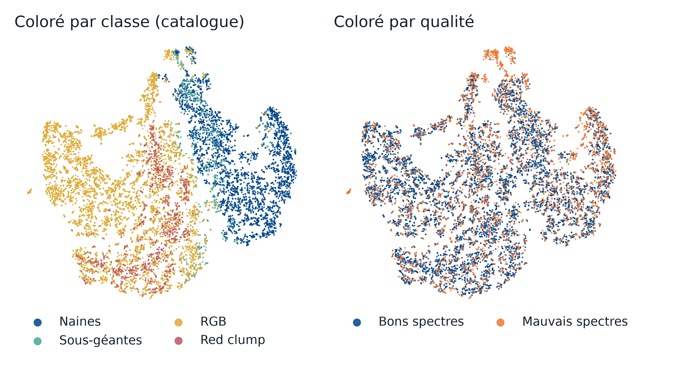
*Figure 1. t-SNE de 10 000 étoiles. Gauche : classes. Droite : qualité.*

Naines et géantes forment deux régions séparées, reliées par les sous-géantes. Le red clump reste mêlé à la RGB. Les mauvais spectres se mêlent aux bons.

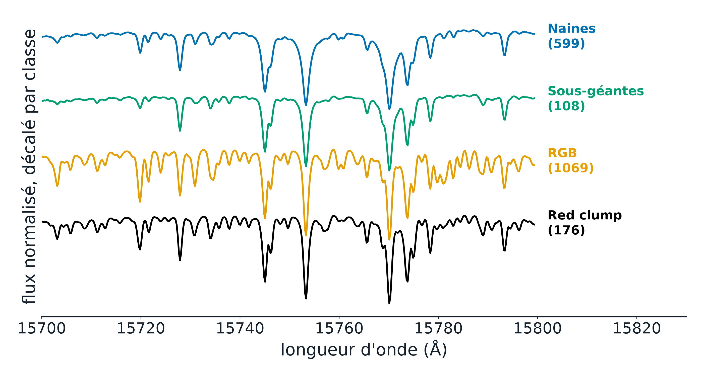
*Figure 2. Spectre moyen de chaque classe sur 130 Å, décalé verticalement.*

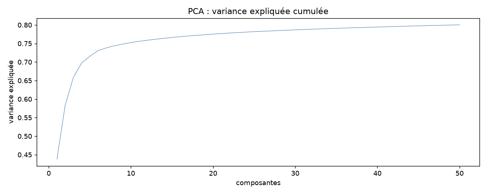
*Figure 3. Variance expliquée par la PCA.*

### 5.2 Clustering

| Entrée | Méthode | ARI | NMI | Pureté OCCAM |
|---|---|---:|---:|---:|
| PCA, bons, k = 3 | **GMM** | **0,41** | **0,52** | 0,90 |
| PCA, bons, k = 4 | GMM | 0,10 | 0,32 | 0,85 |
| PCA, bons, k = 3 | K-means | 0,08 | 0,26 | 0,95 |
| PCA, bons, k = 4 | K-means | 0,06 | 0,26 | 0,91 |
| PCA, bons | HDBSCAN (24 % de bruit) | −0,03 | 0,03 | 0,52 |
| Latent, bons, k = 2 | K-means | −0,07 | 0,13 | 0,99 |
| PCA, tous, k = 2 | GMM | −0,04 | 0,04 | 0,94 |
| PCA, tous, k = 2 | K-means | 0,00 | 0,00 | 1,00 |

Le GMM à trois groupes reste la meilleure méthode. Composition de ses groupes :

| Groupe | Naines | Sous-géantes | RGB | Red clump |
|---|---:|---:|---:|---:|
| A : séquence principale | **73 024** | 10 796 | 7 126 | 201 |
| B : haut de la RGB | 3 | 9 | **55 943** | 463 |
| C : red clump et bas de la RGB | 13 | 2 342 | 74 385 | **22 267** |

```mermaid
sankey-beta
Naines,A séquence principale,73024
Naines,C red clump + bas RGB,13
Sous-géantes,A séquence principale,10796
Sous-géantes,B haut RGB,9
Sous-géantes,C red clump + bas RGB,2342
RGB,A séquence principale,7126
RGB,B haut RGB,55943
RGB,C red clump + bas RGB,74385
Red clump,A séquence principale,201
Red clump,B haut RGB,463
Red clump,C red clump + bas RGB,22267
```

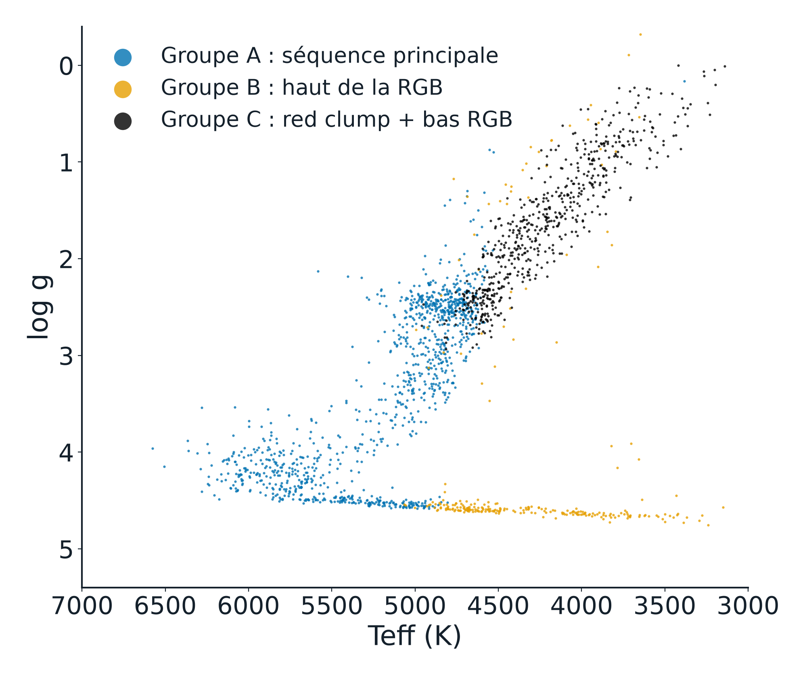
*Figure 4. Diagramme de Kiel des bons spectres, coloré par les groupes du GMM à k = 3.*

À k = 4, l'ARI tombe à 0,10. Le quatrième groupe coupe les naines en deux, et l'un des morceaux absorbe 18 753 étoiles du red clump et 62 668 RGB. La version 2 donnait 0,44 à k = 4, la version 1 donnait 0,09. Le résultat à quatre groupes dépend de l'échantillon.

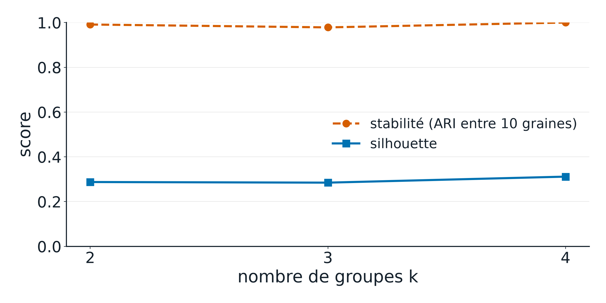
*Figure 5. Silhouette et stabilité de K-means selon k (PCA, bons spectres).*

La silhouette reste basse (maximum 0,28 à k = 3) : les spectres forment un continuum. K-means trouve des groupes stables à k = 4 (stabilité 0,87), mais ces groupes ne suivent pas les classes (ARI 0,06). Les populations galactiques restent introuvables (ARI ≤ 0,11). Sur tous les spectres, la silhouette choisit k = 2 et K-means isole 1 004 étoiles atypiques.

### 5.3 Apprentissage supervisé

| Modèle | Entraînement | Accuracy | Macro F1 | Teff (K) | log g (dex) | [M/H] (dex) |
|---|---|---:|---:|---:|---:|---:|
| Forêt | bons | 0,898 | 0,776 | 26,3 | 0,106 | 0,040 |
| Forêt | tous | 0,902 | 0,791 | 25,2 | 0,093 | 0,037 |
| CNN 1-D | bons | **0,918** | 0,848 | **24,7** | **0,050** | **0,021** |
| CNN 1-D | tous | **0,918** | **0,857** | 45,1 | 0,081 | 0,026 |

*Erreurs absolues moyennes par rapport à ASPCAP, sur `test_good` (37 034 étoiles).*

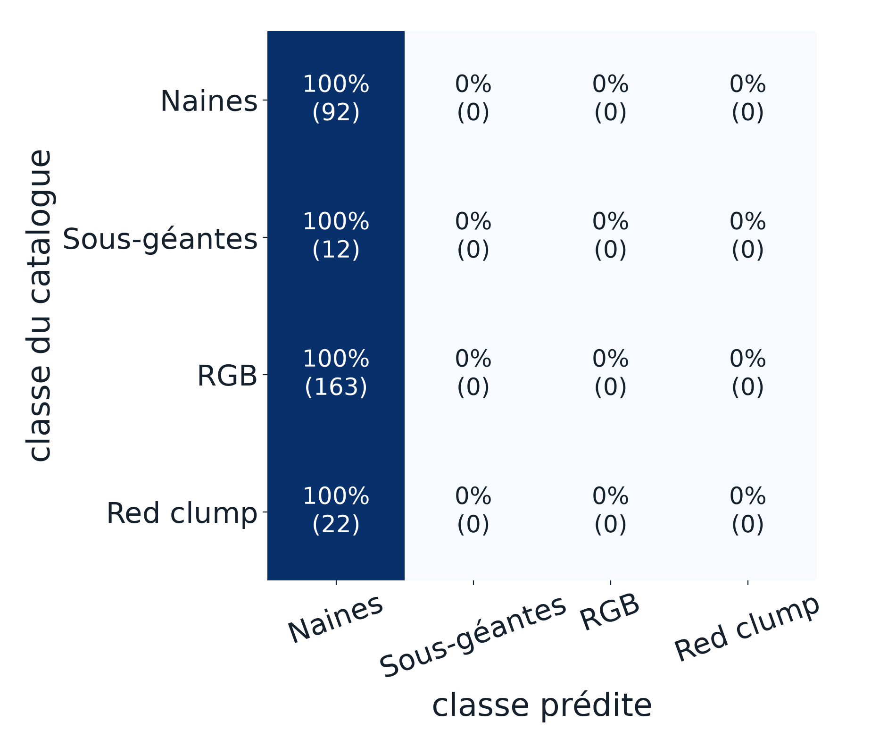
*Figure 6. Matrice de confusion du CNN entraîné sur les bons spectres.*

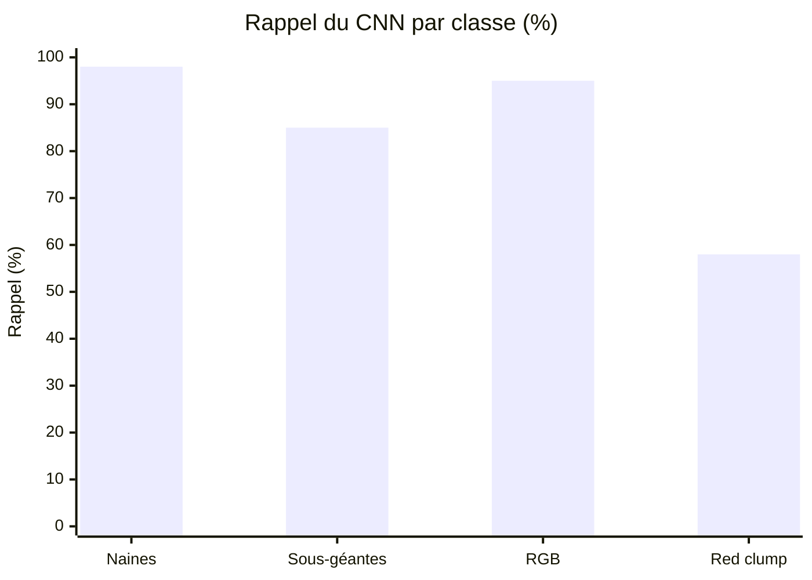

Le CNN reconnaît 98 % des naines, 85 % des sous-géantes et 95 % des RGB. Le red clump plafonne à 58 % : 42 % sont classées RGB. À 100 000 étoiles, la forêt battait le CNN sur Teff. À 370 000, le CNN la dépasse : 24,7 K contre 26,3 K.

### 5.4 Impact de la qualité des données

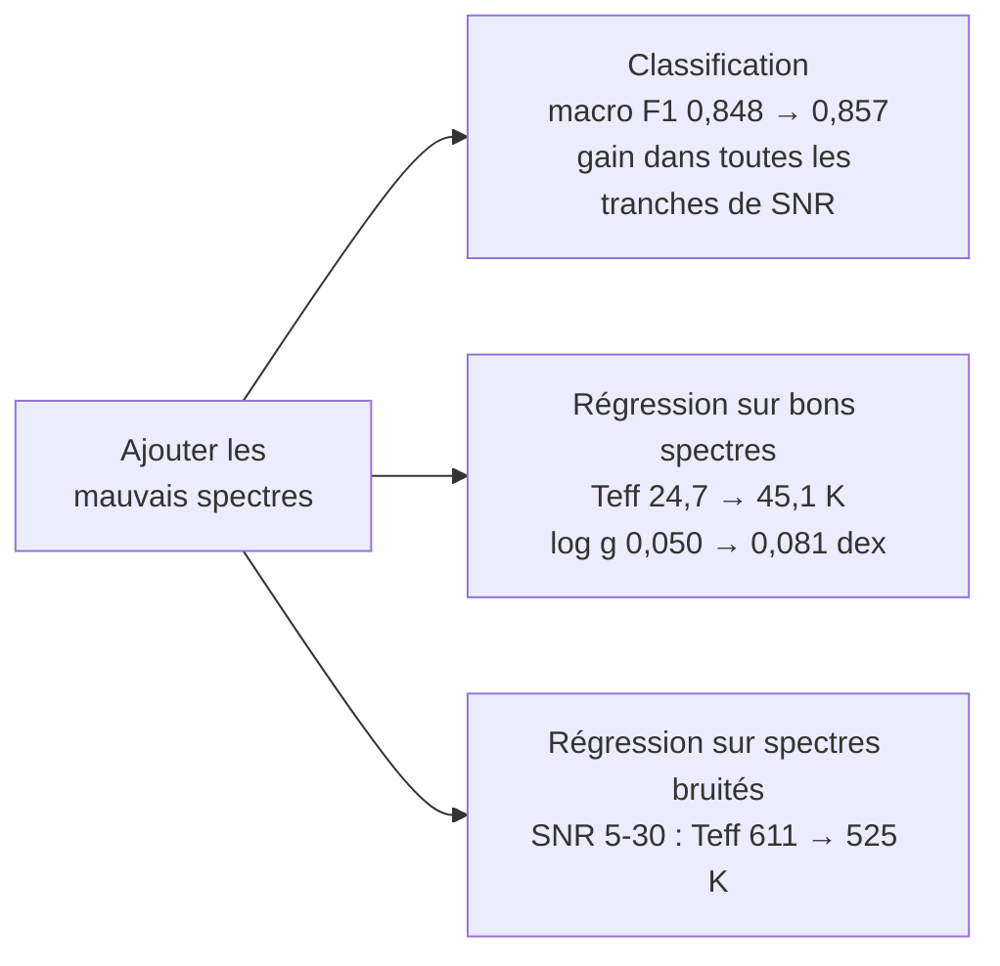

| SNR | n | F1 bons | F1 tous | log g bons | log g tous | Teff bons | Teff tous |
|---|---:|---:|---:|---:|---:|---:|---:|
| 5 à 30 | 1 461 | 0,45 | **0,54** | 0,61 | **0,45** | 611 | **525** |
| 30 à 70 | 4 240 | 0,68 | **0,76** | 0,15 | 0,15 | 167 | **123** |
| 70 à 150 | 22 931 | 0,80 | **0,82** | **0,070** | 0,091 | **62** | 67 |
| > 150 | 26 873 | 0,85 | **0,86** | **0,054** | 0,082 | 58 | **50** |

*CNN par tranche de SNR sur `test_all`, selon le jeu d'entraînement. log g en dex, Teff en K.*

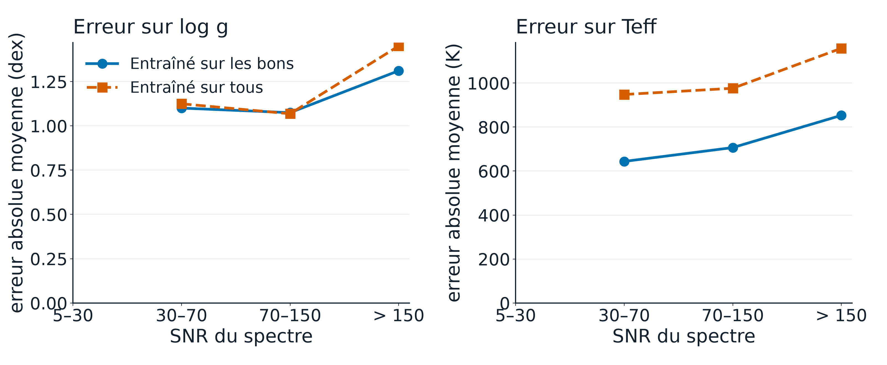
*Figure 7. Erreur du CNN de régression par tranche de SNR.*

L'erreur vient des étiquettes. Sur les 1 504 étoiles de test étiquetées par FPARAM, l'erreur sur Teff atteint 882 K. Le modèle entraîné sur tous les spectres apprend une partie de ce bruit.

| Étiquette | Qualité | n | Teff bons (K) | Teff tous (K) | log g bons / tous (dex) |
|---|---|---:|---:|---:|---:|
| ASPCAP | bonne | 37 034 | 24,7 | 45,1 | 0,050 / 0,081 |
| ASPCAP | mauvaise | 16 967 | 138 | 101 | 0,113 / 0,115 |
| FPARAM | mauvaise | 1 504 | 882 | 514 | 0,541 / 0,412 |

### 5.5 Effet de la taille de l'échantillon

| Mesure | 30 781 | 99 773 | 370 000 |
|---|---:|---:|---:|
| Macro F1, CNN | 0,818 | 0,834 | **0,848** |
| Macro F1, forêt | 0,696 | 0,751 | **0,776** |
| Erreur Teff, CNN (K) | 44,6 | 32,9 | **24,7** |
| Erreur log g, CNN (dex) | 0,083 | 0,069 | **0,050** |
| Erreur [M/H], CNN (dex) | 0,032 | 0,025 | **0,021** |
| Rappel du red clump, CNN | 56 % | 60 % | 58 % |
| ARI, GMM, k = 3 | 0,42 | 0,42 | 0,41 |
| ARI, GMM, k = 4 | 0,09 | 0,44 | 0,10 |

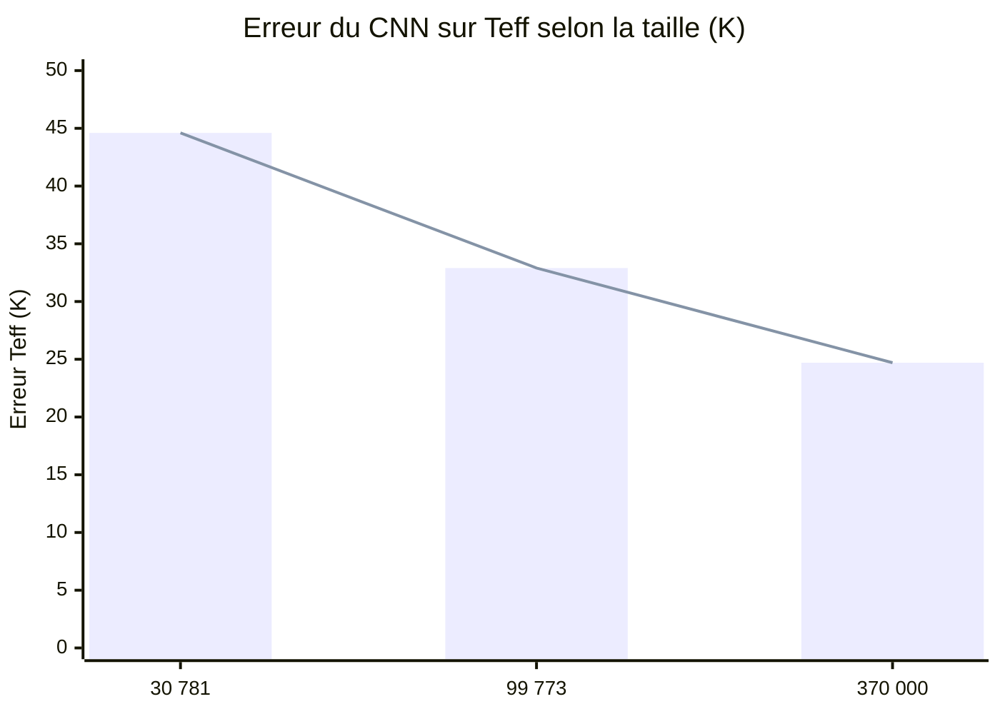

L'erreur sur Teff baisse de 26 % de 30 000 à 100 000 étoiles, puis de 25 % de 100 000 à 370 000. Le macro F1 progresse plus lentement : +0,016 puis +0,014. Le rappel du red clump stagne. Le clustering à k = 3 ne bouge pas.

### 5.6 Temps de calcul

| Étape | Bons spectres (s) | Tous les spectres (s) |
|---|---:|---:|
| Téléchargement des 270 312 spectres manquants | 21 000 env. (une fois) | |
| PCA et t-SNE | 539 (une fois) | |
| Forêt, classes | 99 | 131 |
| Forêt, régression | 308 | 486 |
| CNN, classes (30 époques) | 841 | 1 228 |
| CNN, régression (30 époques) | 842 | 1 214 |
| Autoencodeur | 280 | 383 |
| Clustering sur PCA | 116 | 134 |
| Clustering sur le latent | 125 | 191 |
| **Total** | **7 206 (2 h)** | |

*Portable avec une RTX 3060 (6 Go), 16 threads, 15 Go de mémoire.* L'expérience prend 3 fois plus de temps qu'à 100 000 étoiles pour 3,7 fois plus d'étoiles. Le CNN domine le temps de calcul.

---

## 6. Choix des paramètres et tests de sensibilité

Chaque valeur du projet a une raison, listée dans [`docs/choix_parametres.md`](docs/choix_parametres.md). Les tests changent un paramètre à la fois (`scripts/11_sensitivity.py`).

| Paramètre | Valeur | Raison |
|---|---|---|
| SNR d'un bon spectre | 70 | seuil courant des études ASPCAP |
| Découpage | 70 / 15 / 15 | écart type de l'accuracy de test sous 0,002 |
| Seuils de log g | 4,0 et 3,5 | définitions physiques, non optimisées |
| PCA du clustering | 10 axes | 74,7 % de la variance, 77,0 % à 20 axes |
| k | 3 | silhouette maximale |
| CNN | noyau 7, 3 blocs | un noyau couvre une raie |
| Époques | 30 | meilleure époque de validation gardée |
| Taux d'apprentissage | 0,001 | défaut d'Adam |
| Forêt | 300 arbres, 50 axes | le gain s'arrête vers quelques centaines d'arbres |

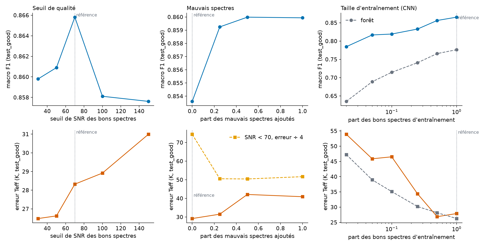
*Figure 8. Effet du seuil de SNR, de la part de mauvais spectres et de la taille d'entraînement.*

- **Seuil de SNR.** 70 donne le meilleur macro F1 (0,866). Pour la régression, 50 fait mieux (26,6 K contre 28,3 K).
- **Mauvais spectres.** 25 % de mauvais spectres font gagner 0,006 de macro F1 sur `test_good` et 0,015 sur `test_all`. En régression, ils nuisent aux bons spectres (29 à 42 K à 50 %).
- **Taille.** Le CNN entraîné sur 2 % des bons spectres (3 450) atteint 0,785 de macro F1, plus que la forêt sur 100 % (0,776).

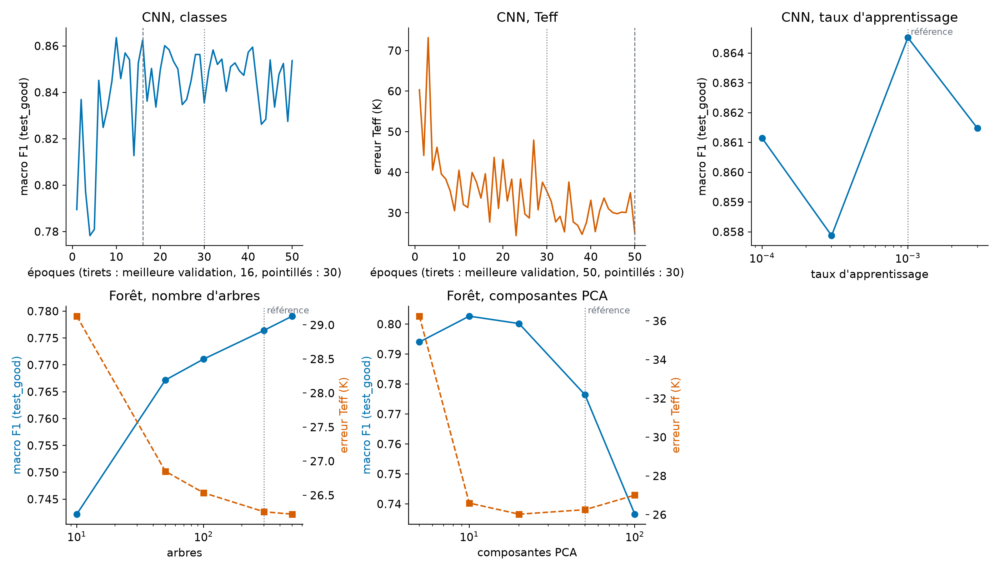
*Figure 9. Courbes du CNN sur 50 époques, taux d'apprentissage, arbres et composantes de la forêt.*

- **Époques.** En classification, la perte de validation atteint son minimum à l'époque 16, puis remonte. En régression, elle baisse encore à 50 : Teff vaut 25,0 K à l'époque 50 contre 35,3 K à 30.
- **Forêt.** 10 composantes donnent 0,803 de macro F1, contre 0,776 avec 50. Avec trop d'axes, chaque arbre tire surtout du bruit.

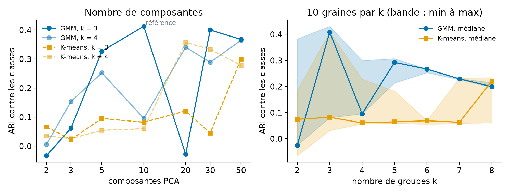
*Figure 10. ARI selon le nombre de composantes et selon k, sur 10 graines.*

Sur 10 graines, l'ARI médian du GMM vaut 0,41 à k = 3. À k = 4, la médiane tombe à 0,10 et le maximum atteint 0,30. Le 0,44 de la version 2 ne se reproduit avec aucune graine.

### 6.1 Bruit des graines et meilleurs réglages

Le même CNN relancé avec les graines 42, 43 et 44 donne 0,852 ± 0,010 de macro F1. Un écart de 0,01 entre deux runs uniques ne prouve rien. Les réglages finaux sont choisis sur la validation, puis mesurés une seule fois sur le test avec 3 graines (`scripts/12_best.py`).

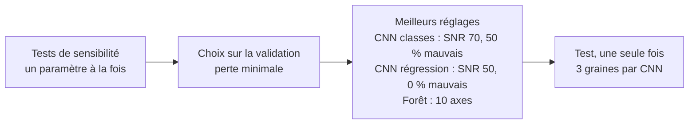

| Modèle | Mesure | Référence | Meilleurs réglages |
|---|---|---:|---:|
| CNN, 3 graines | macro F1, `test_good` | 0,852 ± 0,010 | **0,865 ± 0,000** |
| | macro F1, `test_all` | 0,822 ± 0,009 | **0,847 ± 0,001** |
| | macro F1, SNR < 70 | 0,642 ± 0,023 | **0,738 ± 0,022** |
| | erreur Teff (K) | 26,3 ± 1,6 | 26,6 ± 1,0 |
| | erreur log g (dex) | 0,061 ± 0,002 | **0,055 ± 0,004** |
| Forêt | macro F1, `test_good` | 0,776 | **0,803** |
| | macro F1, SNR < 70 | 0,614 | **0,683** |
| | erreur log g (dex) | 0,106 | **0,085** |
| GMM, k = 3 | ARI | 0,41 (graine 42) | 0,43 (graine 4, BIC minimale) |

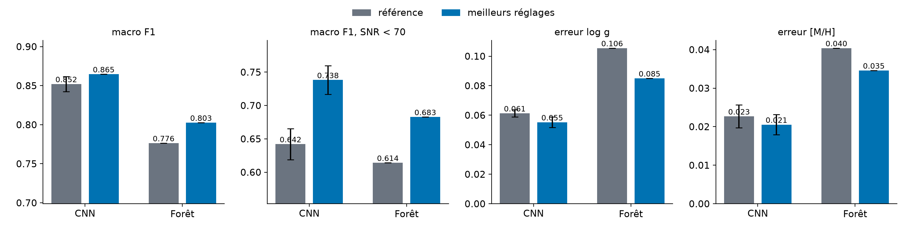
*Figure 11. Référence (gris) contre meilleurs réglages (bleu). Barres : écart type sur 3 graines.*

Le gain le plus net porte sur les spectres de SNR < 70 : 0,738 contre 0,642 pour le CNN.

---

## 7. Red clump contre RGB

Le CNN à quatre classes ne retrouve que 58 % du red clump. Nous entraînons un classifieur binaire sur les géantes à bon spectre : 111 992 en entraînement, 24 221 en test, dont 3 500 du red clump. La perte pondère chaque classe par l'inverse de sa fréquence. Le seuil maximise le F1 du red clump sur la validation.

| Modèle | F1 red clump | Rappel | Précision | AUC |
|---|---:|---:|---:|---:|
| Forêt, Teff, log g, [M/H] | **0,689** | **0,88** | 0,57 | 0,943 |
| Forêt, avec [C/Fe], [N/Fe] | 0,687 | 0,85 | 0,57 | 0,943 |
| Forêt, 10 composantes PCA | 0,646 | 0,82 | 0,53 | 0,931 |
| CNN, 3 graines | 0,683 ± 0,004 | 0,87 | 0,56 | 0,943 |

Le rappel passe de 58 % à 87 %. La précision plafonne à 0,57 pour tous les modèles. Ce plafond commun pointe vers les étiquettes : le catalogue red clump choisit ses étoiles par des coupes réglées pour la pureté.

### 7.1 Étiquettes d'astérosismologie : APOKASC-3

APOKASC-3 (Pinsonneault et al. 2025) donne l'état évolutif de 15 808 géantes du champ Kepler. L'écart de période des modes mixtes sépare un cœur d'hélium inerte (RGB) d'un cœur qui brûle l'hélium (red clump). 10 430 de ces étoiles figurent dans nos spectres. Nous gardons les 7 494 dont l'état vient de l'astérosismologie seule, pour éviter un test circulaire.

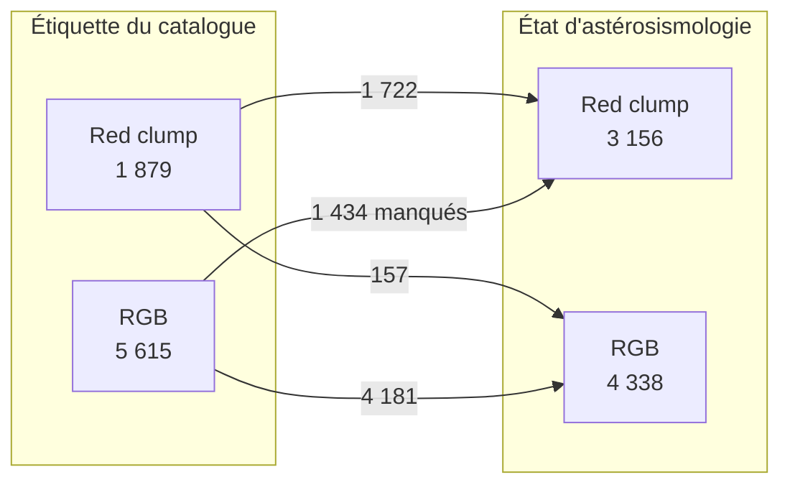

Le catalogue a raison 92 fois sur 100 quand il dit red clump. Il manque 45 % des vraies étoiles du red clump et les étiquette RGB.

Test : 844 géantes de test avec un état d'astérosismologie, dont 339 du red clump.

| Modèle | Étiquettes d'entraînement | F1 red clump | Rappel | Précision | AUC |
|---|---|---:|---:|---:|---:|
| Catalogue red clump | aucune | 0,675 | 0,53 | 0,92 | 0,751 |
| Forêt, paramètres + C, N | catalogue (111 769) | 0,933 | 0,96 | 0,91 | 0,972 |
| CNN | catalogue (111 992) | 0,933 ± 0,012 | 0,95 | 0,92 | 0,983 |
| Forêt, paramètres + C, N | sismologie (5 272) | 0,960 | 0,97 | 0,95 | 0,992 |
| CNN | sismologie (5 284) | 0,971 ± 0,009 | **0,99** | 0,96 | 0,992 |
| **CNN affiné** | catalogue puis sismologie | **0,978 ± 0,003** | **0,99** | **0,97** | **0,996** |

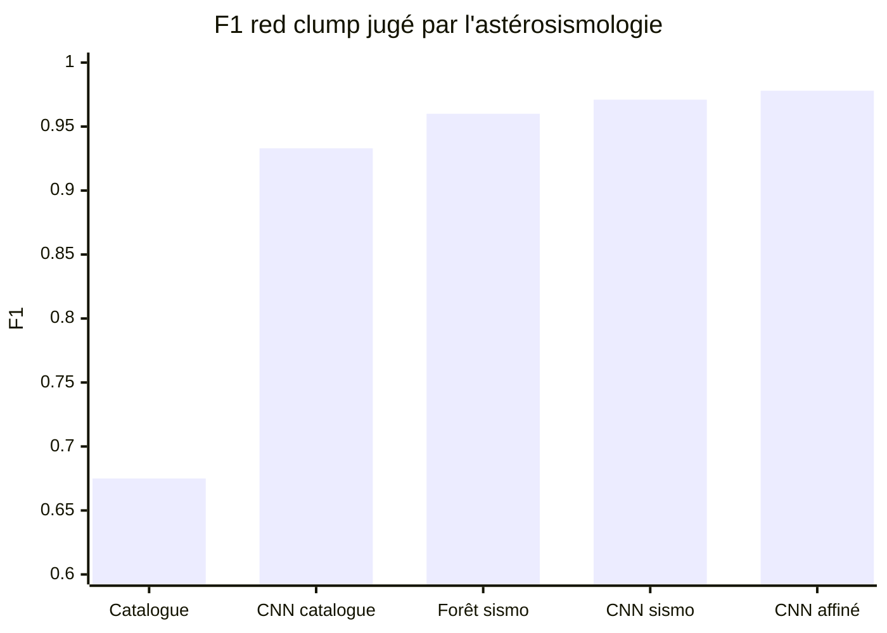

Trois résultats :

1. Nos modèles marchaient déjà. Le CNN entraîné sur le catalogue passe d'un F1 de 0,68 contre le catalogue à 0,93 contre l'astérosismologie. Ses fausses alertes étaient en majorité de vraies étoiles du red clump.
2. De bonnes étiquettes valent plus que beaucoup d'étiquettes. 5 284 étoiles d'astérosismologie portent le CNN à 0,971, avec vingt fois moins de données.
3. Le spectre complet bat les cinq paramètres ASPCAP (0,971 contre 0,960). Le CNN affiné atteint 99 % de rappel et 3 % de contamination, l'ordre de grandeur de Ting, Hawkins et Rix (2018).

Réserves : le test compte 844 étoiles, et toutes viennent du champ Kepler, surtout du disque mince.

---

## 8. Discussion

| | Constat |
|---|---|
| **Tient sur les trois versions** | Séparation naines / géantes sans étiquette. Supériorité du CNN en classification. Effet opposé des mauvais spectres sur classification et régression. |
| **Plafonne** | Le CNN à quatre classes confond 42 % du red clump avec la RGB. La cause : les étiquettes du catalogue. Contre l'astérosismologie, le F1 atteint 0,978. |
| **Ne tient pas** | L'ARI de 0,44 du GMM à k = 4 de la version 2. Sur 10 graines, il ne dépasse pas 0,30. k = 3 reste le choix robuste. |
| **Règle pratique** | Entraîner la régression sur les spectres bruités seulement avec des étiquettes fiables. Les étiquettes FPARAM donnent 882 K d'erreur. |

## 9. Limites et travaux futurs

Limites :

- Les étiquettes viennent d'ASPCAP. Le CNN apprend à reproduire ASPCAP.
- Hors des sections 6.1 et 7, chaque CNN s'entraîne avec une seule graine.
- Le CNN de régression s'arrête à 30 époques, alors que sa perte de validation baisse encore à 50.
- La PCA s'ajuste sur 50 000 spectres et HDBSCAN tourne sur 50 000 étoiles.

Travaux futurs, par priorité :

1. Entraîner la régression sur tous les spectres avec les étiquettes ASPCAP seulement.
2. Entraîner le CNN de régression sur 50 époques ou plus.
3. Répéter chaque entraînement avec 5 graines.
4. Vérifier le classifieur red clump / RGB hors du champ Kepler, avec TESS ou K2.
5. Réétiqueter les 137 454 RGB avec le CNN affiné, puis réentraîner le CNN à quatre classes.

## 10. Conclusion

Sur 370 000 spectres APOGEE, le spectre seul sépare naines et géantes sans étiquette : un GMM à trois groupes atteint un ARI de 0,41 et place 73 024 des 73 040 naines dans un même groupe. Avec étiquettes, le CNN 1-D atteint un macro F1 de 0,865 sur 3 graines et une erreur de 24,7 K sur Teff. La régression gagne le plus à l'échantillon plus grand. La limite red clump / RGB venait des étiquettes : avec APOKASC-3, un CNN sépare les deux classes avec un F1 de 0,978 et 3 % de contamination.

---

## Reproduire

### Installation

```bash
pip install -r requirements.txt
export STARS_DATA=/chemin/vers/un/disque/avec/60Go   # environ 45 Go de données
```

Sans `STARS_DATA`, les scripts écrivent dans `data/` à la racine du projet.

### Pipeline

```bash
python scripts/01_get_catalogs.py        # catalogues APOGEE, red clump, OCCAM (4,2 Go)
python scripts/02_select_stars.py        # échantillon, qualité, étiquettes, split
python scripts/03_download_spectra.py    # spectres, reprise automatique (--seed-from pour réutiliser)
python scripts/04_explore.py             # PCA, t-SNE, UMAP
python scripts/05_baseline.py            # forêt aléatoire
python scripts/06_train.py --model cnn   # CNN 1-D, reprise automatique
python scripts/07_cluster.py             # K-means, GMM, HDBSCAN
python scripts/08_report.py              # tableaux de résultats
python scripts/09_quality_by_snr.py      # performance par tranche de SNR
python scripts/10_label_source.py        # erreurs par origine d'étiquette
python scripts/11_sensitivity.py cluster_dims cluster_k rf_trees rf_pca size epochs snr badfrac lr   # environ 8 h
python scripts/12_best.py                # meilleurs réglages, 3 graines, environ 4 h
python scripts/13_rc_rgb.py              # classifieur red clump / RGB, environ 40 min
python scripts/14_apokasc.py             # étiquettes APOKASC-3 depuis VizieR, environ 45 min
python report/make_figures.py
python report/make_sensitivity_figures.py
```

Toute l'expérience qualité d'un coup : `bash scripts/run_quality_experiment.sh`. Les étapes 01, 03 et 06 reprennent où elles se sont arrêtées. Si `data.sdss.org` ne répond plus, `STARS_SAS=https://dr17.sdss.org` bascule sur le miroir officiel.

### Organisation

```
stars/      code partagé : configuration, catalogue, spectres, modèles, entraînement, figures
scripts/    une étape du pipeline par script, numérotés dans l'ordre d'exécution
docs/       explication de chaque script et des choix de données (commencez par 00_vue_ensemble.md)
results/    tableaux de résultats, tests de sensibilité, red clump / RGB, APOKASC-3
report/     rapport LaTeX, présentation beamer, figures, vue 3D des groupes
```

## Références

- Abdurro'uf et al. (2022). The Seventeenth Data Release of the Sloan Digital Sky Surveys. ApJS, 259, 35.
- Majewski, S. R. et al. (2017). The Apache Point Observatory Galactic Evolution Experiment (APOGEE). AJ, 154, 94.
- García Pérez, A. E. et al. (2016). ASPCAP: The APOGEE Stellar Parameter and Chemical Abundances Pipeline. AJ, 151, 144.
- Garcia-Dias, R. et al. (2018). Machine learning in APOGEE: Unsupervised spectral classification with K-means. A&A, 612, A98.
- Bovy, J. et al. (2014). The APOGEE Red-clump Catalog. ApJ, 790, 127.
- Myers, N. et al. (2022). The Open Cluster Chemical Abundances and Mapping Survey VI. AJ, 164, 85.
- Weinberg, D. H. et al. (2019). Chemical Cartography with APOGEE: Multi-element Abundance Ratios. ApJ, 874, 102.
- van der Maaten, L. et Hinton, G. (2008). Visualizing Data using t-SNE. JMLR, 9, 2579-2605.
- Campello, R. J. G. B., Moulavi, D. et Sander, J. (2013). Density-Based Clustering Based on Hierarchical Density Estimates. PAKDD.
- Hubert, L. et Arabie, P. (1985). Comparing partitions. Journal of Classification, 2, 193-218.
- Ting, Y.-S., Hawkins, K. et Rix, H.-W. (2018). A Large and Pristine Sample of Standard Candles across the Milky Way. ApJL, 858, L7.
- Pinsonneault, M. H. et al. (2025). APOKASC-3. ApJS, 276, 69.
